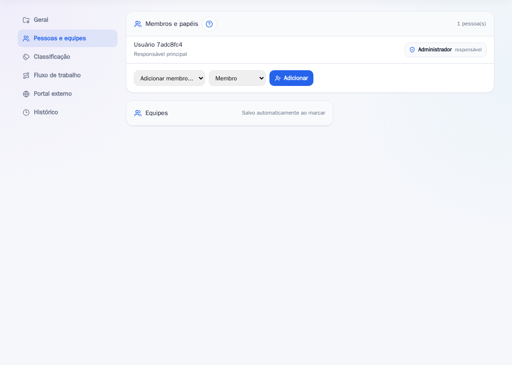

## Criar um projeto {#criar-um-projeto}

1. Abra **Projetos** na barra superior.
2. Clique em **Novo projeto**.
3. Preencha **Nome do projeto** (obrigatório, até 200 caracteres) e, se quiser, **Descrição do projeto**.
4. Escolha a **Natureza** (Projeto, Melhoria ou Sustentação) e o **Tipo de Trabalho** (por exemplo Desenvolvimento, Infraestrutura, Suporte ou Integração).
5. **Data de início** e **Prazo** são opcionais.
6. Clique em **Criar projeto**. O Prisma abre o Backlog do projeto novo.

A chave do projeto é gerada sozinha a partir das iniciais do nome e não precisa ser digitada.

### O que já vem criado {#o-que-vem-criado}

- Você entra no projeto como **Administrador**.
- O fluxo herda o template padrão da organização, se houver um.
- Um quadro chamado **Quadro principal**, com as colunas A fazer, Em andamento e Concluído.

## Dar acesso ao projeto {#dar-acesso-ao-projeto}

Uma pessoa enxerga um projeto quando acontece pelo menos uma destas situações:

- o perfil dela na organização é Administrador, Gestor ou Gerente de projeto (a tela mostra "Administrador pela organização");
- ela é o responsável principal do projeto (sempre Administrador);
- ela foi adicionada como membro do projeto, com um papel;
- ela participa de uma equipe ativa vinculada ao projeto (entra como Membro).

Para adicionar alguém: **Configurações do projeto** > **Pessoas e equipes** > **Membros e papéis**. Escolha a pessoa em **Adicionar membro...**, o papel e clique em **Adicionar**. Para vincular uma equipe inteira, marque **Usar no projeto** na lista **Equipes** (salva na hora). Só o administrador do projeto faz essas mudanças.

### Atribuir não dá acesso {#atribuir-nao-da-acesso}

Atribuir uma tarefa a alguém não dá acesso ao projeto. Se a pessoa ainda não tem acesso, o Prisma recusa com "Conceda acesso ao projeto antes de atribuir a tarefa." A lista de responsáveis só mostra quem já tem acesso.

### Papéis no projeto {#papeis-no-projeto}

| Papel | O que pode |
|---|---|
| Visualizador | ver o projeto |
| Membro | trabalhar nas tarefas e planejar sprints |
| Scrum Master | conduzir as sprints |
| Product Owner | priorizar o backlog |
| Administrador | tudo, inclusive configurações, membros, quadros e Integrações |

## Configurações do projeto {#configuracoes-do-projeto}

Abra a aba **Configurações** do projeto. O menu da esquerda tem estas seções:

- **Geral**: **Dados do projeto** (nome, descrição, responsável, status, natureza, tipo de trabalho e datas, com **Salvar alterações**) e **Ciclo de vida** (**Arquivar projeto** preserva tarefas, horas, sprints e histórico; **Reativar projeto** desfaz).
- **Pessoas e equipes**: membros, papéis e equipes vinculadas (veja acima).
- **Classificação**: etiquetas e campos personalizados.
- **Fluxo de trabalho**: atalho para as colunas, que se configuram no Kanban.
- **Portal externo**: formulário público para receber solicitações.
- **Histórico**: as alterações administrativas do projeto.
- **Integrações**: aparece só quando a instalação tem as integrações habilitadas (veja [Integrações](/ajuda/integracoes/integracoes)).

### Classificação {#classificacao}

Em **Etiquetas do projeto**, clique nas etiquetas que valem para o projeto; elas são salvas junto com os dados gerais. Em **Campos personalizados**, informe o nome do campo, o tipo e se é **Obrigatório**, e clique em **Criar**. Para campos de lista, informe as opções separadas por vírgula.

### Fluxo de trabalho {#fluxo-de-trabalho}

Cada quadro tem as próprias colunas. Use **Configurar colunas no Kanban** para criar, renomear, ordenar ou excluir colunas (veja [Colunas](/ajuda/quadro-backlog-e-sprints/quadro-kanban#colunas)).

### Portal externo {#portal-externo}

Defina o **Quadro de entrada** (onde as solicitações viram cards), o **Endereço público**, o modo de acesso (link público, login, convite ou código por e-mail) e marque **Portal habilitado**. Clique em **Salvar portal**. Os **Formulários de entrada** definem os campos que o solicitante preenche.

### Histórico {#historico}

Lista as mudanças administrativas do projeto (dados, membros, ciclo de vida) com data e autor.
