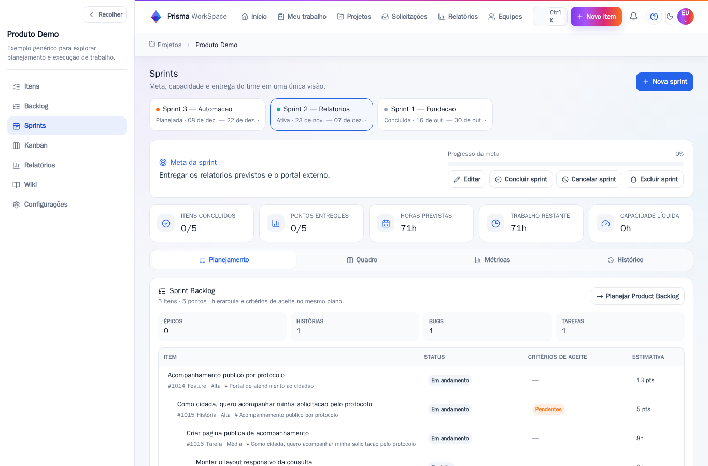

## Visão geral {#sprints}

A aba **Sprints** do projeto mostra as sprints, os indicadores (itens concluídos, pontos entregues, horas previstas, trabalho restante e capacidade líquida) e as visões **Planejamento**, **Quadro**, **Métricas** (burndown e velocidade) e **Histórico**.

Gerenciar sprints exige a permissão de gerenciar sprint e pelo menos o papel Membro no projeto.

## Criar uma sprint {#criar-uma-sprint}

1. Clique em **Nova sprint**.
2. Em **Planejar nova sprint**, escolha a **Equipe (opcional)**, informe **Nome** (por exemplo "Sprint 26"), **Meta**, **Início** e **Fim**.
3. Clique em **Criar sprint**.

O fim precisa ser posterior ao início: "O fim deve ser posterior ao início."

## Estado da sprint {#estado-da-sprint}

Não existe botão de iniciar: o estado vem das datas. Antes do início a sprint está **Planejada**; entre o início e o fim, **Ativa**. Depois de encerrada fica **Concluída** ou **Cancelada**.

## Concluir ou cancelar {#concluir-ou-cancelar}

- **Concluir sprint** aparece com a sprint ativa.
- **Cancelar sprint** encerra sem concluir.
- **Editar** muda nome, meta, equipe e datas.

### Itens não concluídos {#itens-nao-concluidos}

Ao concluir ou cancelar, o Prisma mostra quantos itens não foram concluídos e pede um destino: **Retornar ao Product Backlog** ou **Enviar para outra sprint** (escolha a **Sprint de destino**).

## Excluir uma sprint {#excluir-uma-sprint}

**Excluir sprint** devolve as tarefas ao Product Backlog, no mesmo quadro e na mesma coluna. Nenhuma tarefa é excluída.
